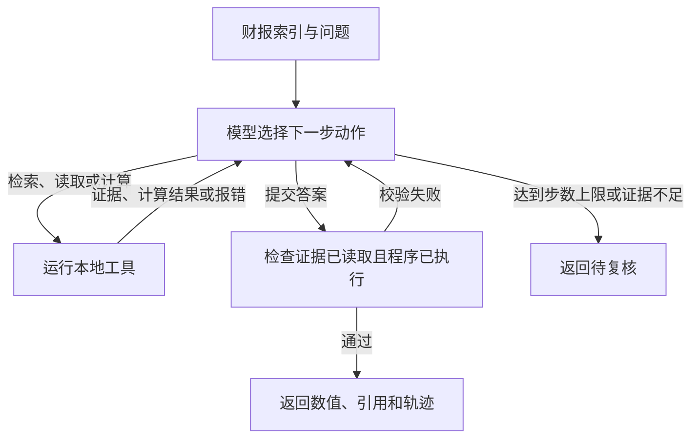

# 金融财报问答 Agent 与反馈驱动的提示词优化

输入结构化财报和数值问题，Agent 可以检索报告片段、读取证据、执行计算，并根据工具结果决定下一步。它返回数值答案、证据编号和工具执行轨迹。项目还提供基于 FinQA 的 GEPA 实验，用于比较基础问答提示词优化前后的表现。

**技术栈** · Python · DSPy · LLM Agent · Tool Calling · GEPA · FinQA

## Agent 如何工作



| 动作 | 作用 |
| --- | --- |
| `search_report` | 在当前报告内检索相关文本或表格行 |
| `read_report` | 按来源编号读取原文与表格数据 |
| `calculate` | 执行受限算术程序，返回结果或错误 |
| `finish` | 提交已执行的程序、证据编号和解释 |

例如，收入从 100 增至 120 时，模型可以提交 `subtract(120, 100), divide(#0, 100)`。Python 执行器计算出 `0.2`，表示增长 20%。提交检查覆盖引用是否已读取、算式是否已执行。财务口径和证据相关性由后续评测验证。[真实模型执行轨迹](docs/agent-example.json)

## 快速开始

使用 Python 3.12 或 3.13。Windows PowerShell 中运行以下命令：

```powershell
python -m venv .venv
.\.venv\Scripts\Activate.ps1
python -m pip install -r requirements.txt
python agent.py demo
python run.py demo
```

macOS 或 Linux 可使用 `source .venv/bin/activate` 激活环境。

`agent.py demo` 用预设动作演示取证、计算报错、修正与提交。`run.py demo` 用脚本模型和合成数据演示 GEPA 搜索、验证集选择与测试评分。两条命令均可离线运行，所得分数用于展示流程。

## 接入模型 API

运行 `python configure.py`，填写平台的兼容 API 地址、模型 ID 和本地密钥。也可以复制 `config.example.json` 为 `config.local.json` 并填写配置，或通过 `FINQA_API_KEY` 环境变量提供密钥。Git 已忽略本地配置。

```powershell
python agent.py ask
```

默认读取仓库内的合成收入表。可用 `--data-file` 指定报告 JSON 列表，使用 `--index` 选取报告，使用 `--question` 提出新问题。报告格式见 [示例输入](data/agent-demo-report.json)。结果写入 `agent-runs/`。

输入、输出单价以元／百万 token 填写。确认免费时填 `0`。也可以用 `--unpriced` 运行并将费用记录为未知。Agent 默认最多决策 6 步，实际 HTTP 请求和每次输出 token 数受配置限制。

## GEPA 实验

GEPA 根据程序执行结果和错误反馈优化**基础问答模块**的提示词。验证集用于选择候选，留出集用于评估最终提示词。通过 Agent 的 `--rules` 参数可加载已保存的 `optimized-instructions.json`，作为计算规则参考。Agent 工具决策策略的直接优化和批量评测待完成。

```powershell
python run.py prepare --source official --train 12 --dev 6 --test 10
python run.py smoke --data-dir data
python run.py live --data-dir data --feedback detailed
```

数据准备从 [FinQA 作者仓库](https://github.com/czyssrs/FinQA) 下载公开标注，并记录来源版本与哈希。可用 `--feedback score` 运行只提供正误反馈的对照配置。结果、候选提示词及报告写入 `runs/`，支持用 `--resume latest` 复用已完成预测。

现有实验包括一个真实模型 Agent 样例，以及 10 道教学留出题上的基础问答对照。实验条件、结果和解释范围见 [实验记录](docs/experiments.md)。

## 代码入口

| 文件 | 作用 |
| --- | --- |
| `agent.py` | 决策循环、工具和提交校验 |
| `interpreter.py` | 算术程序解析与执行 |
| `core.py` | 数据处理、标签隔离和评分 |
| `run.py` | GEPA 搜索、留出评测与报告 |
| `models.py`、`transport.py` | API 适配、流式响应与调用限制 |
| `checkpoints.py`、`optimization_checkpoint.py` | 保存并复用预测与优化记录 |

运行 `python -m unittest discover -v` 执行本地测试。

## 参考

- [FinQA: A Dataset of Numerical Reasoning over Financial Data](https://arxiv.org/abs/2109.00122)
- [GEPA: Reflective Prompt Evolution Can Outperform Reinforcement Learning](https://arxiv.org/abs/2507.19457)
- [DSPy](https://github.com/stanfordnlp/dspy)
